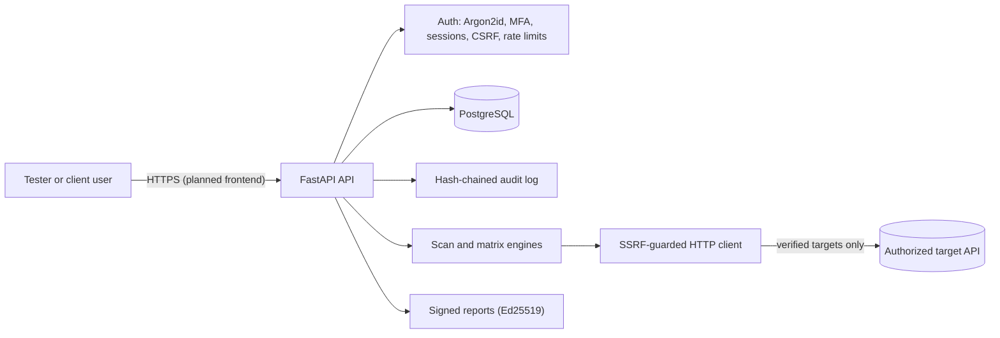

# ScopeGuard

A secure engagement platform for application-security testers. Register an authorized target, prove you own it, run safe checks, test for broken object-level authorization with two identities, track findings through retesting, and export a cryptographically signed report.

**Status:** backend complete (247 automated tests, CI green). Frontend, background worker and LLM drafter are not built yet.

**How it was built:** step by step with AI assistance, as a learning project for an application-security internship. I reviewed the code and can explain each control and its limits (see the table below and SECURITY.md).

## What it does

1. **Engagements and findings.** Role-based access with an ownership check on every object.
2. **Target ownership verification.** The owner publishes a random token at `/.well-known/scopeguard-verification.txt`. Proof expires after 30 days. Nothing is sent to a target that is not freshly verified.
3. **Safe scan engine.** GET-only configuration checks: security headers, cookie flags, CORS reflection, version disclosure, exposed `.git`, `.env` and `/server-status` (detected by content signature), and TLS certificate status.
4. **Authorization matrix engine.** From an OpenAPI file and two test identities it replays GET endpoints as the owner, as another user and anonymously. A finding is confirmed only by a deterministic response comparison. A control request for a non-existent object removes catch-all false positives. No LLM decides what is true.
5. **Retesting.** Findings are fingerprinted. A re-scan never duplicates them, and a finding marked fixed that still reproduces reopens as `not_fixed`. A fix is closed only by a person.
6. **Signed reports.** Immutable Markdown snapshots signed with Ed25519, plus an offline verifier (`tools/verify_report.py`).

## Architecture



More detail is in `docs/architecture.md` and the threat model in `docs/threat-model.md`.

## Security controls and where they map (OWASP Top 10:2025)

| OWASP 2025 category | Controls in this project | Coverage |
| --- | --- | --- |
| A01 Broken Access Control | Central ownership check, 404 for other users' objects, role checks, mass-assignment blocked, an "every endpoint as the wrong user" test matrix | Strong for the implemented endpoints |
| A02 Security Misconfiguration | Security headers, secure cookie flags, lab mode honoured only in development, local-only database port | Good |
| A03 Software Supply Chain Failures | Pinned `requirements.txt`, `pip-audit` and Bandit in CI | Partial |
| A04 Cryptographic Failures | Argon2id, AES-256-GCM with the user ID as AAD, keyed HMAC, Ed25519, key separation | Good |
| A05 Injection | ORM and parameterized queries only, report text escaped, input validated with Pydantic | Good |
| A06 Insecure Design | Threat model, fail-closed behaviour, deterministic verifier, authorization confirmation | Good |
| A07 Authentication Failures | Lockout, per-IP rate limits, TOTP MFA with replay protection, session rotation, generic errors | Good |
| A08 Software or Data Integrity Failures | Signed reports, hash-chained append-only audit log | Good |
| A09 Security Logging and Alerting Failures | Audit log of security events with IDs only. No alerting yet. | Partial |
| A10 Mishandling of Exceptional Conditions | Fail closed on missing keys and scope errors, fixed error reasons | Partial |

The categories above are the official OWASP Top 10:2025 list, checked against owasp.org.

## Quick start (Windows, PowerShell)

Requirements: Python 3.11+, Docker Desktop, Git.

```powershell
git clone https://github.com/Astra2153/ScopeGuard.git ScopeGuard
cd ScopeGuard
docker compose up -d
cd backend
python -m venv .venv
.\.venv\Scripts\Activate.ps1
pip install -r requirements.txt
```

Create `.env` in the project root from `.env.example`, then generate a master key (never commit it):

```powershell
cd ..
Copy-Item .env.example .env
$k = python -c "import secrets,base64;print(base64.b64encode(secrets.token_bytes(32)).decode())"
Add-Content -Encoding ascii .env "MASTER_KEY=$k"
```

Migrate and run:

```powershell
cd backend
alembic upgrade head
uvicorn app.main:app --reload
```

Open http://127.0.0.1:8000/docs for the interactive API documentation.

## Demo: find, fix, retest

`tools/demo.py` drives the real API against a local practice target and writes two signed reports. It needs three PowerShell windows, each with the virtual environment active:

| Window | Folder | Command |
| --- | --- | --- |
| A | `backend` | `uvicorn app.main:app` |
| B | `backend` | `python ..\tools\lab_target.py` |
| C | project root | `python tools/demo.py` |

Local targets need `ALLOW_PRIVATE_TARGETS=true` in `.env` (honoured only when `APP_ENV=development`). The script:

1. Registers a demo user, an engagement and a target, and proves ownership.
2. Runs the configuration scan (8 findings) and the authorization matrix (confirms broken object-level authorization).
3. Signs report 1, "fixes" the target, and marks every finding fixed.
4. Re-scans. The fixes hold, but plain HTTP still reproduces, so that finding reopens as `not_fixed`.
5. Signs report 2 and verifies both reports offline. A tampered copy fails verification.

A fix is never accepted on trust: a later scan that still sees the issue reopens it.
## Tests

```powershell
cd backend
python -m pytest -q
```

Tests use a separate `scopeguard_test` database that is created automatically. They cover access control, authentication, MFA, the audit chain, SSRF defences, scan checks, the authorization engine and report signing.

## Verify a report offline

```powershell
python tools\verify_report.py REPORT.md SIGNATURE_BASE64 PUBLIC_KEY_BASE64
```

The signature comes from the `X-Report-Signature` header of the download, and the public key from `GET /reports/public-key`.

## Safe use

Only scan systems you own or have written permission to test. The scanner refuses unverified targets, uses GET only, and sends at most a few dozen requests per run. Local practice targets require an explicit development-only lab setting.

## Known limits

- Object-level GET testing only. No vertical-privilege, injection or business-logic testing.
- The audit log's database role could still drop its triggers. A production setup would use an insert-only role.
- The signing and encryption keys come from one master key in `.env`. Production would use a KMS with rotation.
- There is no trusted timestamping, so a signed date does not prove when a report existed.
- Rate limiting is in memory and per process. Production would use Redis.
- Scans run inside the API request. A background worker is planned.


